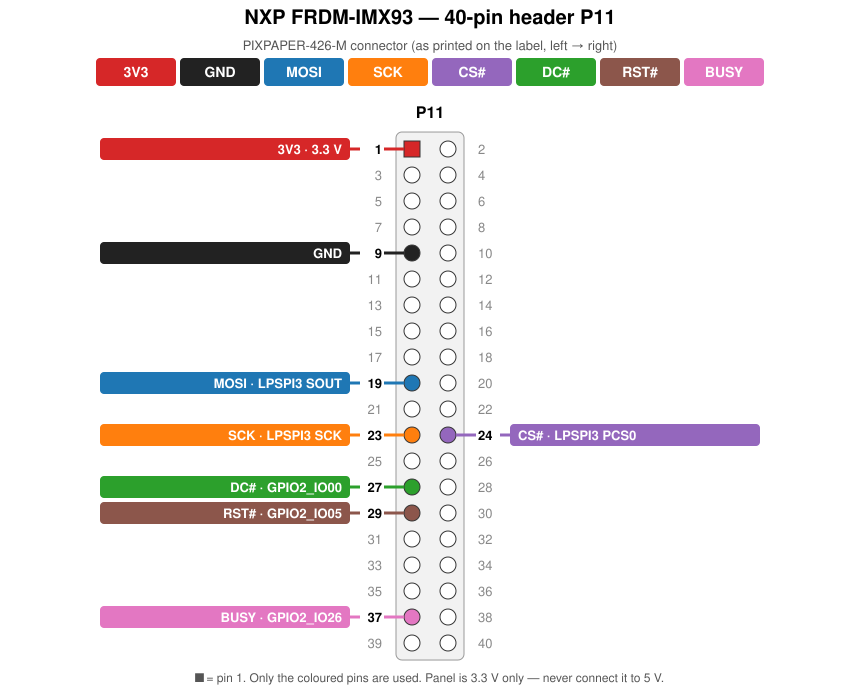

[](https://www.gnu.org/licenses/old-licenses/gpl-2.0.en.html)

# PIXPAPER-426-M on NXP FRDM-IMX93 — Linux

| Item | Value |
|---|---|
| Board | [NXP FRDM-IMX93](https://www.nxp.com/design/design-center/development-boards-and-designs/FRDM-IMX93) (Cortex-A55) |
| Tested | kernel 6.6, 6.12 |
| Interface | `/dev/spidev0.0` + 3 GPIOs on `gpiochip0` |
| Demo source | [pixpaper-426-m-test-frdm-imx93.c](https://github.com/open-ep/linux-user-space-examples/blob/master/4.26/mono/spi/pixpaper-426-m-test-frdm-imx93.c) |

> Want a real display driver (`/dev/dri/card*`) instead of a user-space demo? See the [DRM driver guide](linux-kernel-drm/DRM-FRDM-IMX93_PIXPAPAER-426-M.md).

## 1. Wiring

Power the board off before wiring. The panel is **3.3 V only** — never use a 5 V pin.



| Panel | P11 pin | SoC signal |
|---|---|---|
| 3V3 | 1 | 3.3 V |
| GND | 9 (any GND) | GND |
| MOSI | 19 | LPSPI3 SOUT |
| SCK | 23 | LPSPI3 SCK |
| CS# | 24 | GPIO2_IO08 (LPSPI3 CS) |
| DC# | 27 | GPIO2_IO00 (gpiochip0 line 0) |
| RST# | 29 | GPIO2_IO05 (line 5) |
| BUSY | 37 | GPIO2_IO26 (line 26) |

<details><summary>Photo of a finished setup</summary>


</details>

## 2. Enable SPI

Nothing to do — the stock image already provides the SPI device.

**Check:** `ls /dev/spidev0.0` prints `/dev/spidev0.0`.

## 3. Build and run the demo

> Needs **libgpiod 1.x** — check with `gpioinfo --version` (must say `v1.x`).

> Yocto image: add `IMAGE_INSTALL:append = " libgpiod libgpiod-dev libgpiod-tools packagegroup-core-buildessential"` to `conf/local.conf`, rebuild, then run the commands below on the board (skip the `apt` line).

```bash
sudo apt install -y gcc wget gpiod libgpiod-dev
mkdir -p ~/pixpaper-426m && cd ~/pixpaper-426m
BASE=https://raw.githubusercontent.com/open-ep/linux-user-space-examples/master/4.26/mono/spi
wget $BASE/pixpaper-426-m-test-frdm-imx93.c $BASE/image_output.h
gcc -o epd_test pixpaper-426-m-test-frdm-imx93.c -lgpiod
sudo ./epd_test
```

## 4. Expected result

The panel does a full refresh (it flashes) and shows the sample picture, then redraws it every 30 s until you press **Ctrl+C**.

https://github.com/user-attachments/assets/d21c83b3-4c74-4a72-a7ff-33159d94f2e8

## 5. Show your own picture (mono / grayscale)

```bash
sudo apt install -y python3-opencv
wget $BASE/png2bit_426.py
python3 png2bit_426.py your_image.png --mode gray4   # or --mode mono / --mode gray8
gcc -o epd_test pixpaper-426-m-test-frdm-imx93.c -lgpiod
sudo ./epd_test gray4                               # same mode as above
```

| Mode | Convert with | Run with | Notes |
|---|---|---|---|
| mono | `--mode mono` | `sudo ./epd_test` | black / white |
| gray4 | `--mode gray4` | `sudo ./epd_test gray4` | 4 gray levels, faster than gray8 |
| gray8 | `--mode gray8` | `sudo ./epd_test gray8` | 8 gray levels |

`png2bit_426.py` resizes any PNG to 800 × 480 (landscape) and always writes `image_output.h` (`-o` is ignored).
The **mode used to convert must match the mode you run** — a mono header is 48 000 bytes, a gray header 384 000 bytes.
The downloaded sample `image_output.h` is **mono** — use it only with `sudo ./epd_test`.

## Troubleshooting

| Symptom | Fix |
|---|---|
| `/dev/spidev0.0` missing | SPI is not enabled → redo step 2 and reboot. |
| Compile error `implicit declaration of function 'gpiod_chip_open_by_name'` | Your OS has libgpiod 2.x; this demo needs 1.x (`gpioinfo --version`). |
| Garbage / noise in gray mode | `image_output.h` was made in a different mode → convert again with the same `--mode` you run. |
| `Failed to request GPIO` / line busy | Another driver owns GPIO2_IO00/05/26. `gpioinfo gpiochip0` shows the user. If you rewire, edit `EPD_DC_PIN` / `EPD_RST_PIN` / `EPD_BUSY_PIN` in the `.c`. |
| Runs, but the screen never changes | Check 3V3 and GND first, then that MOSI and SCK are not swapped. |
| Hangs at 100 % CPU, no flashing | BUSY or RST# wire is loose. |

## Contributors

Thanks goes to these wonderful people from open source community:

<!-- ALL-CONTRIBUTORS-LIST:START - Do not remove or modify this section -->
<!-- prettier-ignore-start -->
<!-- markdownlint-disable -->
<table>
  <tbody>
    <tr>
        <td align="center" valign="top" width="14.28%"><a href="https://github.com/wigcheng"><br /><sub><b>Wig Cheng</b></sub></a><br /><a href="https://github.com/wigcheng/open-epd/commits?author=wigcheng" title="Code">💻</a></td>
    </tr>
  </tbody>
</table>

<!-- markdownlint-restore -->
<!-- prettier-ignore-end -->

<!-- ALL-CONTRIBUTORS-LIST:END -->

---

