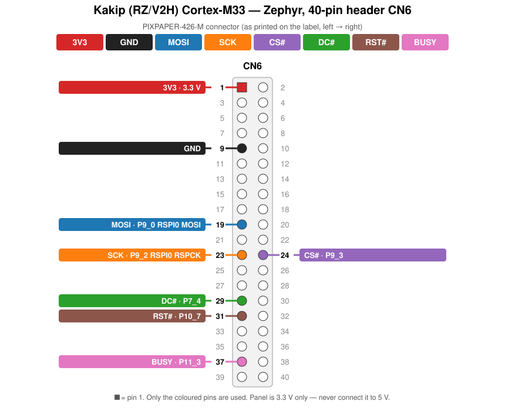

[](https://www.gnu.org/licenses/old-licenses/gpl-2.0.en.html)

# PIXPAPER-426-M on Kakip Cortex-M33 — Zephyr + LVGL

| Item | Value |
|---|---|
| Board | [Kakip](https://www.kakip.ai/) (Renesas RZ/V2H), firmware on the **Cortex-M33** |
| Zephyr target | `rzv2h_evk/r9a09g057h44gbg/cm33` + a Kakip overlay (pulled in automatically) |
| Boot chain | TF-A 2.10 (`BOARD=kakip_1`) + U-Boot 2024.07; the M33 is started from the U-Boot prompt |
| Host | Ubuntu (x86-64), Zephyr SDK ≥ 1.0 |
| Source | [zephyr-user-space-examples → kakip/samples/pixpaper_426m](https://github.com/open-ep/zephyr-user-space-examples/tree/main/boards/kakip/samples/pixpaper_426m) |

The panel is a real Zephyr **display device**, so anything that uses the display API runs on it, including LVGL. Two apps:

| App | What it shows |
|---|---|
| `image` | One full refresh of a picture, then a progress bar drawn with partial refreshes, timed. Start here. |
| `lvgl` | An LVGL dashboard (clock, arc, bar) that updates once a second, or LVGL's own widgets demo. |

Linux is not involved: the A55 stays at the U-Boot prompt while the M33 drives the panel.
The Cortex-R8 cannot drive the panel (Zephyr has no SPI driver for it), but it can run its own firmware at the same time — see [dual_core_hello](https://github.com/open-ep/zephyr-user-space-examples/tree/main/boards/kakip/samples/dual_core_hello).

## 1. Wiring

Power the board off before wiring. The panel is **3.3 V only** — never use a 5 V pin.



| Panel | CN6 pin | RZ/V2H pin |
|---|---|---|
| 3V3 | 1 | 3.3 V |
| GND | 9 | GND |
| MOSI | 19 | P9_0 (RSPI0 MOSI) |
| SCK | 23 | P9_2 (RSPI0 RSPCK) |
| CS# | 24 | P9_3 |
| DC# | 29 | P7_4 |
| RST# | 31 | P10_7 |
| BUSY | 37 | P11_3 |

These are the same pins as Kakip's Linux PIXPAPER overlay, so one set of wires serves both — but never load that Linux overlay while the M33 firmware runs.

**M33 console** (where the result is printed): a **3.3 V** USB-UART adapter, 115200 8N1, on the same header:

| CN6 pin | Signal | Adapter |
|---|---|---|
| 6 | GND | GND |
| 8 | P7_2, SCI5 TXD | RXD |
| 10 | P7_3, SCI5 RXD | TXD |

The A55 U-Boot console stays on the board's usual debug UART, in a second terminal.

## 2. Install the toolchain (once per PC)

```bash
sudo apt install -y cmake ninja-build device-tree-compiler python3-venv wget git
cd ~
wget https://github.com/zephyrproject-rtos/sdk-ng/releases/download/v1.0.1/zephyr-sdk-1.0.1_linux-x86_64_minimal.tar.xz
tar xf zephyr-sdk-1.0.1_linux-x86_64_minimal.tar.xz
cd zephyr-sdk-1.0.1
./setup.sh -t arm-zephyr-eabi -c   # -c registers it so west finds it
```

If more than one Zephyr SDK is installed, add `export ZEPHYR_SDK_INSTALL_DIR=~/zephyr-sdk-1.0.1` before building.

## 3. Create the Zephyr workspace (once)

```bash
mkdir ~/zephyrproject && cd ~/zephyrproject
python3 -m venv .venv
.venv/bin/pip install west
.venv/bin/west init .
.venv/bin/west update hal_renesas cmsis_6 lvgl   # only the modules this sample needs
.venv/bin/pip install -r zephyr/scripts/requirements-base.txt

git clone https://github.com/open-ep/zephyr-user-space-examples.git ~/zephyr-user-space-examples
# register the open-ep devicetree vendor prefix in the Zephyr tree
git -C ~/zephyrproject/zephyr apply \
    ~/zephyr-user-space-examples/boards/kakip/samples/pixpaper_213m/patches/0001-dts-bindings-add-open-ep-vendor-prefix.patch
```

**Check:** `grep open-ep ~/zephyrproject/zephyr/dts/bindings/vendor-prefixes.txt` prints one line. (If `git apply` complains, the prefix is already there — skip it.)

## 4. Build

```bash
cd ~/zephyrproject
HERE=~/zephyr-user-space-examples/boards/kakip/samples/pixpaper_426m

.venv/bin/west build -p always -b rzv2h_evk/r9a09g057h44gbg/cm33 -d build-426-image $HERE/apps/image
.venv/bin/west build -p always -b rzv2h_evk/r9a09g057h44gbg/cm33 -d build-426-lvgl  $HERE/apps/lvgl
```

For LVGL's own widgets demo instead of the dashboard, add `-- -DCONFIG_LV_USE_DEMO_WIDGETS=y` to the `lvgl` line.

**Check:** `ls build-426-image/zephyr/zephyr.bin` exists.

## 5. Start the M33 from U-Boot

1. Copy `build-426-image/zephyr/zephyr.bin` to the **root of the SD card's first partition** (FAT) and rename it **`kakip_cm33.bin`**.
2. Boot the Kakip, stop at the U-Boot `=>` prompt, and paste this whole line:

```
dcache off; mw.l 0x10420D2C 0x02000000; mw.l 0x1043080c 0x08003000; mw.l 0x10430810 0x18003000; mw.l 0x10420604 0x00040004; mw.l 0x10420C1C 0x00003100; mw.l 0x10420C0C 0x00000001; mw.l 0x10420904 0x00380008; mw.l 0x10420904 0x00380038; fatload mmc 0:1 0x58000000 kakip_cm33.bin; cp.b 0x58000000 0x08003000 ${filesize}; mw.l 0x10420C0C 0x00000000; dcache on
```

U-Boot prints `... bytes read`, then the M33 starts. To try the other app, copy its `zephyr.bin` over `kakip_cm33.bin` and paste the line again — no power cycle needed.

The image is loaded into DDR first and then copied into SRAM because U-Boot 2024.07 refuses to `fatload` directly into SRAM (`Reading file would overwrite reserved memory`).

## 6. Expected result

**`image`:** the panel flashes for about 4 s (full refresh) and shows the picture, then a progress bar fills in with partial refreshes. The M33 console prints:

```text
<inf> app: Full refresh of the image...
<inf> app: Image shown in ~4000 ms
<inf> app: round 0: 25 partial refreshes, ... ms each on average
```

**`lvgl`:** one full refresh puts up the first screen, the console prints `LVGL running`, then the clock, arc and bar update with one partial refresh per second.

## Troubleshooting

| Symptom | Fix |
|---|---|
| No output at all on the M33 console | The M33 is not running: check `fatload` printed `bytes read` and the file is named `kakip_cm33.bin`. Check the adapter on CN6 8/10 (TX/RX crossed). |
| `BUSY stuck high` after ~10 s | The panel never answered the reset: check 3V3 (pin 1), GND, RST# (pin 31) and BUSY (pin 37). |
| Log looks normal, panel stays blank | Data is not arriving: check SCK (23), MOSI (19), CS# (24), DC# (29). |
| Image breaks up or has a band of wrong pixels | Lower `spi-max-frequency` (20 MHz) in `common/kakip_cm33.overlay`, e.g. to 4 MHz, and rebuild. |
| `Unhandled IRQn: 144` | A UART receive error with interrupts disabled; the samples set `CONFIG_UART_INTERRUPT_DRIVEN=y` for this — keep it. |
| Build: `open-ep` vendor prefix unknown | Step 3's `git apply` was skipped. |

Tuning knobs (full refresh every N partials, partial LUT timing, SPI chunk size) are in the [sample README](https://github.com/open-ep/zephyr-user-space-examples/blob/main/boards/kakip/samples/pixpaper_426m/README.md).
