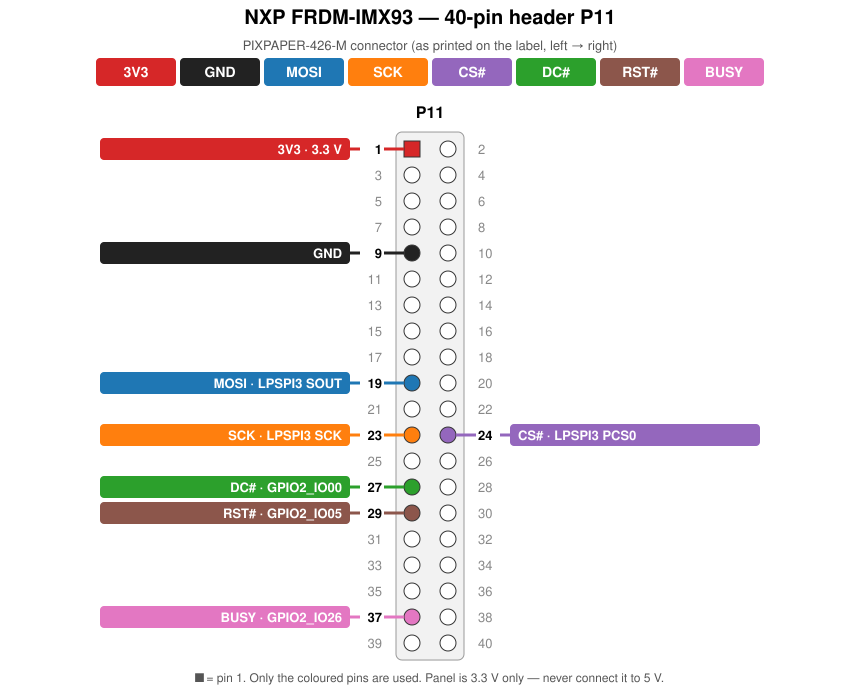

[](https://www.gnu.org/licenses/old-licenses/gpl-2.0.en.html)

# PIXPAPER-426-M DRM driver on NXP FRDM-IMX93 — Linux kernel 6.12

The panel becomes a normal Linux display (`/dev/dri/cardN`, `/dev/fbN`). Any DRM/KMS or framebuffer program can draw on it.

| Item | Value |
|---|---|
| Board | [NXP FRDM-IMX93](https://www.nxp.com/design/design-center/development-boards-and-designs/FRDM-IMX93) |
| Kernel | NXP vendor kernel `lf-6.12.y`, device tree `imx93-11x11-frdm.dts` |
| Driver | 3 patches in [`frdm-imx93-kernel-6.12/`](frdm-imx93-kernel-6.12/) → `CONFIG_TINYDRM_PIXPAPER426M` |

> Only need to show a picture? The [user-space guide](../FRDM-IMX93_PIXPAPAER-426-M.md) needs no kernel rebuild.
> This guide replaces the board's `spidev` on LPSPI3, so the user-space demo stops working afterwards.

## 1. Wiring

Same wiring as the user-space guide. Power the board off first; the panel is **3.3 V only**.



| Panel | P11 pin | SoC signal | Device tree |
|---|---|---|---|
| 3V3 | 1 | 3.3 V | |
| GND | 9 (any GND) | GND | |
| MOSI | 19 | LPSPI3 SOUT | `&lpspi3` |
| SCK | 23 | LPSPI3 SCK | `&lpspi3` |
| CS# | 24 | GPIO2_IO08 | `cs-gpios = <&gpio2 8 ...>` |
| DC# | 27 | GPIO2_IO00 | `dc-gpios = <&gpio2 0 ...>` |
| RST# | 29 | GPIO2_IO05 | `reset-gpios = <&gpio2 5 ...>` |
| BUSY | 37 | GPIO2_IO26 | `busy-gpios = <&gpio2 26 ...>` |

## 2. Get the kernel and apply the driver

```bash
git clone https://github.com/open-ep/PIXPAPER-426-M.git
git clone -b lf-6.12.y https://github.com/nxp-imx/linux-imx.git
cd linux-imx
P=../PIXPAPER-426-M/linux-kernel-drm/frdm-imx93-kernel-6.12
git am $P/0001-drm-tiny-add-support-for-Pixpaper-426M-e-ink-panel.patch \
       $P/0001-drm-tiny-pixpaper-426m-add-ARGB8888-format-support.patch \
       $P/0001-drm-tiny-pixpaper-426m-fix-mirror-issue.patch
```

**Check:** `ls drivers/gpu/drm/tiny/pixpaper-426m.c` exists.

## 3. Device tree

In `arch/arm64/boot/dts/freescale/imx93-11x11-frdm.dts`, `&lpspi3` and `pinctrl_lpspi3` **already exist**. Replace only the `spidev0` child with the panel. Do **not** add another `pinctrl_lpspi3` — dtc fails on the duplicate label.

```diff
 &lpspi3 {
 	fsl,spi-num-chipselects = <1>;
 	pinctrl-names = "default";
 	pinctrl-0 = <&pinctrl_lpspi3>;
 	cs-gpios = <&gpio2 8 GPIO_ACTIVE_LOW>;
 	pinctrl-assert-gpios = <&pcal6408 0 GPIO_ACTIVE_HIGH>;
 	status = "okay";
 
-	spidev0: spi@0 {
-		reg = <0>;
-		compatible = "lwn,bk4";
-		spi-max-frequency = <1000000>;
-	};
+	display@0 {
+		compatible = "mayqueen,pixpaper-426m";
+		reg = <0>;
+		spi-max-frequency = <1000000>;
+		reset-gpios = <&gpio2 5 GPIO_ACTIVE_HIGH>;
+		dc-gpios = <&gpio2 0 GPIO_ACTIVE_HIGH>;
+		busy-gpios = <&gpio2 26 GPIO_ACTIVE_HIGH>;
+	};
 };
```

The compatible must be exactly `"mayqueen,pixpaper-426m"` — that is the only string the driver matches.

## 4. Configure and build

Cross-compile on an x86-64 PC (`sudo apt install gcc-aarch64-linux-gnu`), or build on the board (drop the two `export` lines).

```bash
export ARCH=arm64
export CROSS_COMPILE=aarch64-linux-gnu-
make imx_v8_defconfig
scripts/config --module TINYDRM_PIXPAPER426M        # or --enable for built-in
make olddefconfig
make -j$(nproc) Image dtbs modules
```

**Check:** `grep PIXPAPER426M .config` prints `CONFIG_TINYDRM_PIXPAPER426M=m` (or `=y`).

## 5. Install

Copy these to the board's boot partition and rootfs. On the board itself, use `/boot` and `/`.

```bash
cp arch/arm64/boot/Image                               <boot>/
cp arch/arm64/boot/dts/freescale/imx93-11x11-frdm.dtb  <boot>/
sudo make INSTALL_MOD_PATH=<rootfs> modules_install
```

Reboot the board.

## 6. Verify and test

```bash
dmesg | grep -i pixpaper        # driver probed, no errors
ls /dev/dri/                    # a new cardN appears
sudo modetest -M pixpaper -c    # note the connector id   (modetest: apt install libdrm-tests)
sudo modetest -M pixpaper -s <connector_id>:800x480
```

**Expected:** `modetest` draws its test pattern on the panel. The panel flashes during the refresh.


To send text from a PC browser, see the [Text Sender guide](epaper_text_sender_guide.md).

## Troubleshooting

| Symptom | Fix |
|---|---|
| dtc error `Duplicate label 'pinctrl_lpspi3'` | You added a second pinctrl group. Remove it; the one in the board file is correct. |
| Nothing in `dmesg`, no new `/dev/dri/card` | The driver did not bind. Check the compatible string is `"mayqueen,pixpaper-426m"`, the new `.dtb` is the one being booted, and (for `=m`) that `modprobe pixpaper-426m` works. |
| Driver probes, screen never changes | Check 3V3 and GND, then MOSI/SCK. Check DC = pin 27, RST = pin 29, BUSY = pin 37. |
| `modetest: failed to open device` | Use `-M pixpaper`, the driver's DRM name, and run as root. |

## Contributors

Thanks goes to these wonderful people from open source community:

<!-- ALL-CONTRIBUTORS-LIST:START - Do not remove or modify this section -->
<!-- prettier-ignore-start -->
<!-- markdownlint-disable -->
<table>
  <tbody>
    <tr>
        <td align="center" valign="top" width="14.28%"><a href="https://github.com/wigcheng"><br /><sub><b>Wig Cheng</b></sub></a><br /><a href="https://github.com/wigcheng/open-epd/commits?author=wigcheng" title="Code">💻</a></td>
    </tr>
  </tbody>
</table>

<!-- markdownlint-restore -->
<!-- prettier-ignore-end -->

<!-- ALL-CONTRIBUTORS-LIST:END -->

---
